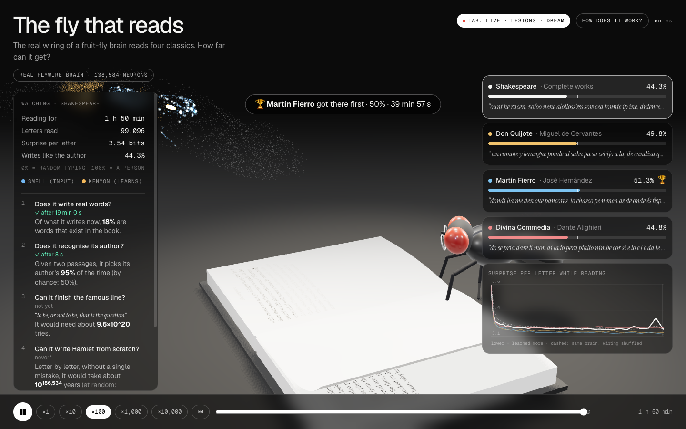
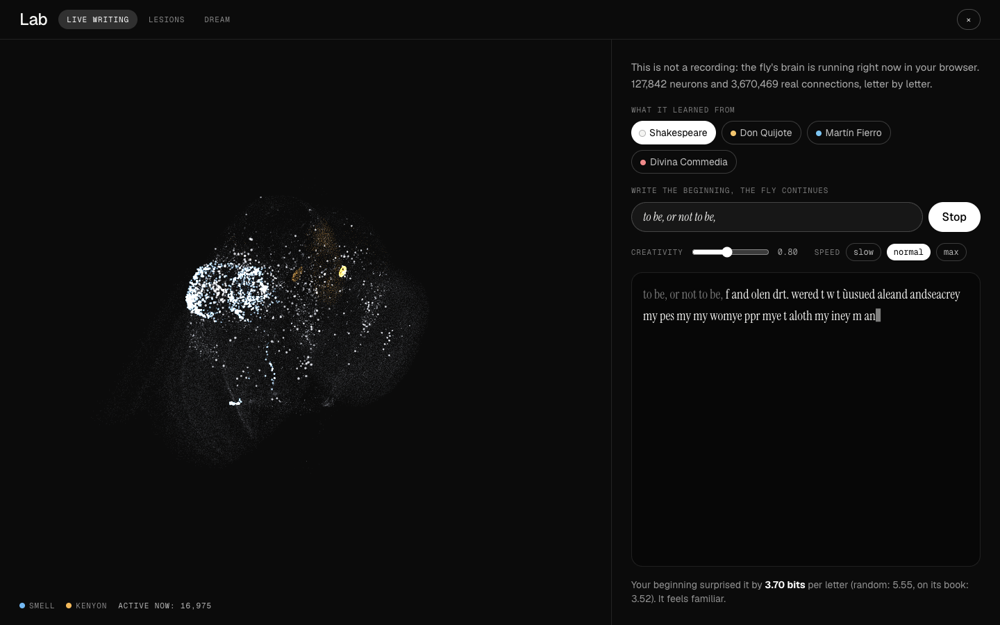
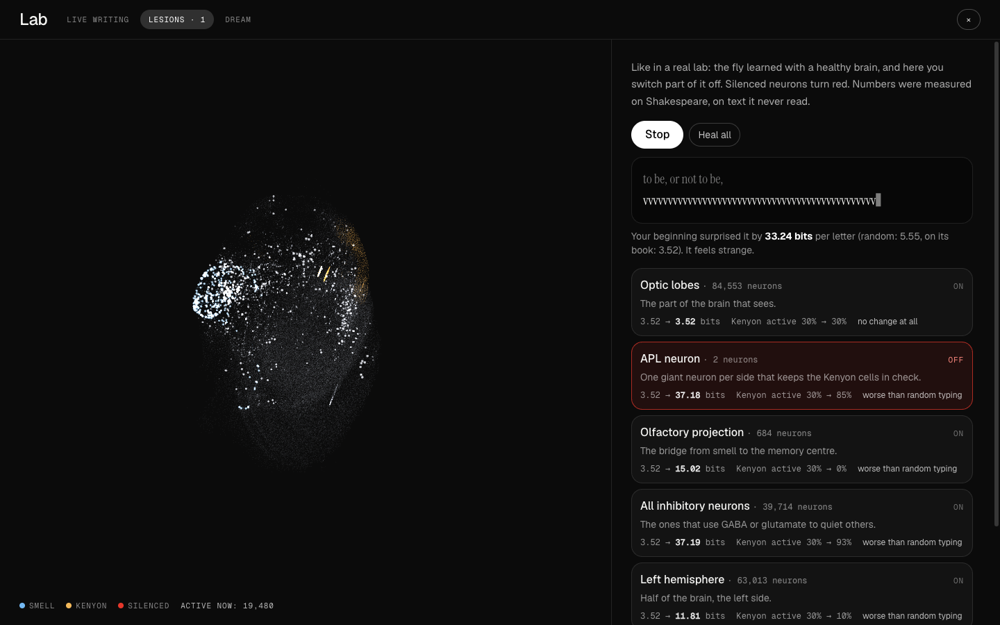

# The fly that reads · La mosca que lee

**[▶ Live demo](https://tomasvales.github.io/fly-that-reads/)** · 🇬🇧 [English](#english) · 🇦🇷 [Español](#español)



---

## English

What happens when the **real wiring of a fruit-fly brain** reads Shakespeare, Cervantes, Hernández and Dante?

This project takes the complete connectome of an adult *Drosophila* brain (FlyWire FAFB v783: ~139,000 neurons, ~3.7 million connections, ~50 million synapses) and lets it read four classics letter by letter. An interactive 3D page replays the experiment: a fly with reading glasses turns the pages while its brain lights up, four books race each other, and you can speed time up from ×1 to ×10,000.

### The lab: a fly brain running in your browser

| Live writing | Lesions |
|---|---|
|  |  |

The **Lab** button opens a second mode where nothing is pre-recorded: 127,842 neurons and 3,670,469 real connections run in a Web Worker, letter by letter (~20–45 letters per second on a laptop).

- **Live writing:** type a beginning, pick which book it learned from, and the fly continues. Every neuron that fires lights up in 3D, and it tells you how surprised it was by your text.
- **Lesions:** switch parts of the brain off, even mid-sentence, and watch what it writes.
- **Dream:** with no book in front of it, the fly writes and listens to itself. The colour shows which book it is dreaming of.

### Results

**Reading (100,000 letters per book):** the fly goes from random typing (5.55 bits per letter) to 3.2–3.5 bits. It writes words that exist (~40%), sounds like the right language for each book, and tells its author apart from the others 83–99% of the time. But the **same brain with its wiring shuffled at random learns just as much** (3.42 vs 3.42 bits on Shakespeare): what it learns comes from the size and dynamics of the network, not from the fly's actual wiring.

**Lesions** (the fly learns with a healthy brain, then a group of neurons is silenced; bits per letter on unseen Shakespeare, lower is better):

| Silenced | Neurons | Bits/letter | Writes |
|---|---:|---:|---|
| nothing (healthy) | 0 | 3.52 | *"than th t dof he my, by toof and"* |
| optic lobes | 84,553 | 3.52 | no change: it reads through smell |
| **APL neuron** | **2** | **37.2** | *"vvvvvvvvvvvv"* |
| all inhibitory neurons | 39,714 | 37.2 | *"vvvvvvvvvvvv"* |
| olfactory projection neurons | 684 | 15.0 | *"tt ttt rttrrttr"* |
| left hemisphere | 63,013 | 11.8 | almost only spaces |
| half, at random | 63,921 | 16.2 | *"tttttttttt"* |

The two **APL** neurons (one per side) were found automatically: they are the inhibitory neurons that talk to ~2,600 Kenyon cells each. Silencing just those 2 out of 127,842 breaks reading exactly as much as silencing all 39,714 inhibitory neurons. Kenyon cells go from 30% active to 85%, and the fly gets stuck on one letter.

### How it works

- **Wiring:** every real connection is used as-is. Its weight grows with the number of synapses (log) and its sign comes from the predicted neurotransmitter (GABA and glutamate inhibit, the rest excite).
- **Reading:** each letter activates a fixed group of olfactory receptor neurons, the main route into the fly's memory centre. The letter is "smelled" for 3 time steps (`x ← tanh(W·x + input)`), so activity travels layer by layer and deeper layers keep a trace of previous letters.
- **Learning:** the wiring never changes. Only the connections leaving the 5,177 **Kenyon cells** of the mushroom body are trained (a linear softmax readout with Adam), as in real flies.
- **Exams**, on passages the fly never read: surprise per letter, share of real words, author recognition, tries needed to finish the book's most famous line, and years needed to write the work exactly from scratch (longer than the age of the universe).
- **Lab brain:** the neurons that can be reached from smell *and* reach the Kenyon cells. The rest never activate or never influence the output, so removing them is exact. The browser engine matches PyTorch to ~1e-8.

### Run it

```bash
python3 -m venv .venv && .venv/bin/pip install numpy scipy pandas torch
# put the FlyWire FAFB v783 files in data/ (connections, classification, coordinates, neurotransmitters)
# put the Project Gutenberg books in books/ (ids 100, 2000, 14765, 1012)
.venv/bin/python pipeline/run.py --train 100000   # main experiment → web/public/data/run.json (~3.5 h on an M-series GPU)
.venv/bin/python pipeline/live.py --train 30000   # lab brain + lesions → web/public/lab/brain.bin (~1 h)
.venv/bin/python pipeline/pack.py                 # repack brain.bin (~11 MB)
cd web && npm install && npm run dev
```

The experiments run on the Apple GPU (Metal) through PyTorch when available, otherwise on the CPU.

### Caveats

A real fly doesn't read. This measures how well the wiring of a fly brain, used as a fixed recurrent network, can learn the statistics of text. The input encoding, time steps, weights and readout are modelling choices, and the lesions are simulated on that model, not on a living fly.

---

## Español

¿Qué pasa si el **cableado real del cerebro de una mosca de la fruta** lee a Shakespeare, Cervantes, Hernández y Dante?

El proyecto toma el conectoma completo del cerebro de una *Drosophila* adulta (FlyWire FAFB v783: ~139.000 neuronas, ~3,7 millones de conexiones, ~50 millones de sinapsis) y lo pone a leer cuatro clásicos, letra por letra. Una página 3D interactiva reproduce el experimento: una mosca con anteojos pasa las páginas mientras su cerebro se ilumina, los cuatro libros compiten en una carrera y podés acelerar el tiempo de ×1 a ×10.000.

### El laboratorio: un cerebro de mosca corriendo en tu navegador

El botón **Laboratorio** abre un segundo modo donde nada está grabado: 127.842 neuronas y 3.670.469 conexiones reales corren en un Web Worker, letra por letra.

- **Escribe en vivo:** escribís un comienzo, elegís de qué libro aprendió y la mosca sigue. Cada neurona que se activa se enciende en 3D, y te dice cuánto la sorprendió tu texto.
- **Lesiones:** apagás partes del cerebro, incluso mientras escribe, y ves qué le pasa.
- **Sueño:** sin ningún libro delante, la mosca escribe y se escucha a sí misma. El color muestra con qué libro está soñando.

### Resultados

**Lectura (100.000 letras por libro):** la mosca pasa de teclear al azar (5,55 bits por letra) a 3,2–3,5 bits. Escribe palabras que existen (~40%), suena al idioma de cada libro y distingue a su autor de los otros entre el 83% y el 99% de las veces. Pero el **mismo cerebro con los cables mezclados al azar aprende lo mismo** (3,42 contra 3,42 bits con Shakespeare): lo que aprende sale del tamaño y la dinámica de la red, no del cableado real de la mosca.

**Lesiones:** la mosca aprende con el cerebro sano y después se apaga un grupo de neuronas (ver la tabla de arriba). Apagar los **lóbulos ópticos** (84.553 neuronas) no le cambia nada, porque lee con el olfato. Apagar las **2 neuronas APL**, que el programa encontró solo por cómo se conectan, la rompe exactamente igual que apagar las 39.714 inhibidoras: las células de Kenyon pasan del 30% al 85% activas y la mosca se traba escribiendo *"vvvvvvvv"*.

### Cómo funciona

- **Cableado:** se usa cada conexión real tal cual. Su peso crece con la cantidad de sinapsis y su signo sale del neurotransmisor predicho (GABA y glutamato inhiben, el resto excita).
- **Lectura:** cada letra activa un grupo de neuronas receptoras olfativas, el camino principal hacia el centro de memoria de la mosca. La letra se "huele" durante 3 pasos, así que la actividad viaja capa por capa y las capas profundas guardan el rastro de las letras anteriores.
- **Aprendizaje:** el cableado nunca cambia. Solo se entrenan las conexiones que salen de las 5.177 **células de Kenyon** del cuerpo fungiforme, igual que en las moscas reales.
- **Exámenes**, sobre partes del libro que nunca leyó: sorpresa por letra, palabras reales, reconocer al autor, intentos para completar la frase más famosa y cuánto tardaría en escribir la obra exacta desde cero (más que la edad del universo).

### Advertencias

Una mosca real no lee. Esto mide qué tan bien el cableado de un cerebro de mosca, usado como red recurrente fija, puede aprender las estadísticas de un texto. La forma de codificar las letras, los pasos de tiempo, los pesos y la lectura de salida son decisiones de modelado, y las lesiones se simulan sobre ese modelo, no sobre una mosca viva.

---

### Data & credits

- **Connectome:** FlyWire, FAFB v783. Please cite:
  - Dorkenwald, S. et al. *Neuronal wiring diagram of an adult brain.* Nature 634, 124–138 (2024).
  - Schlegel, P. et al. *Whole-brain annotation and multi-connectome cell typing of Drosophila.* Nature 634, 139–152 (2024).
  - Eckstein, N. et al. *Neurotransmitter classification from electron microscopy images at synaptic sites in Drosophila melanogaster.* Cell 187, 2574–2594 (2024).
- **Books:** Project Gutenberg (public domain): *The Complete Works of William Shakespeare* (#100), *Don Quijote* (#2000), *El Gaucho Martín Fierro* (#14765), *La Divina Commedia* (#1012).

Made by [Tomas Vales](https://tomasvales.github.io/).
